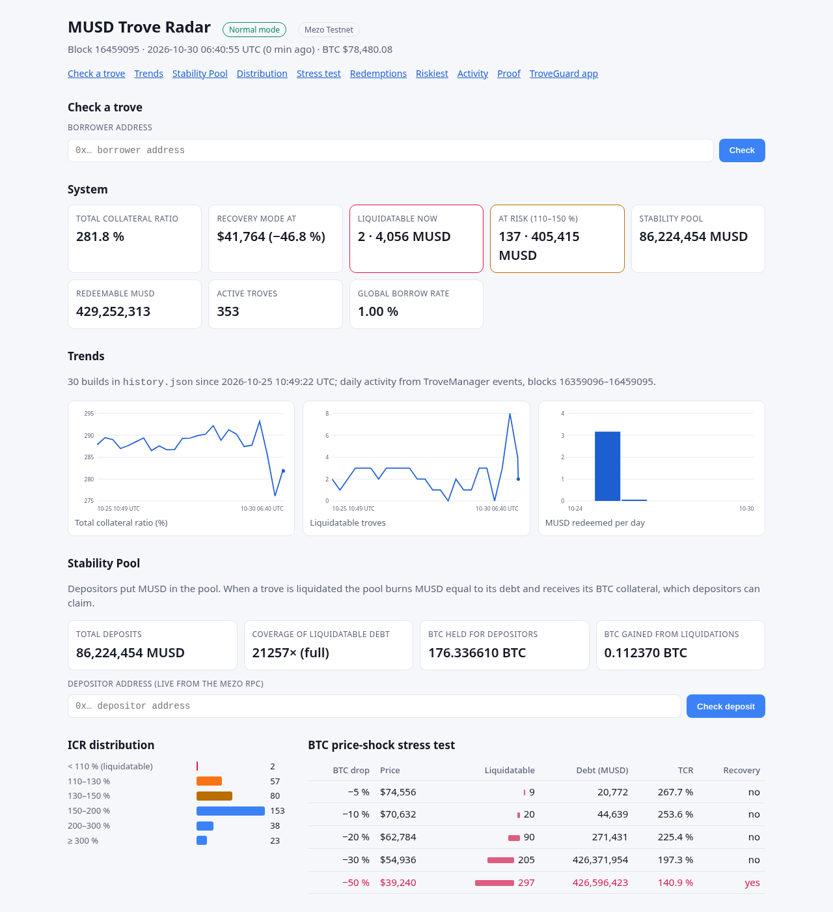
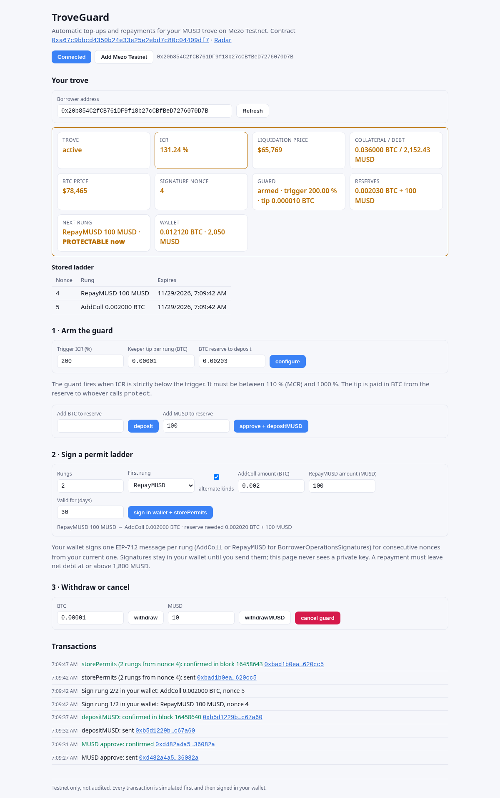

# MUSD Trove Radar

**A liquidation and Recovery Mode radar, plus a permissionless liquidation keeper, for MUSD troves on Mezo.**

MUSD is minted against BTC in troves. When a trove's collateral ratio (ICR) drops below 110 % it can be liquidated. If the whole system's ratio (TCR) drops below 150 %, Mezo enters Recovery Mode. Borrowers, Stability Pool depositors and keepers each need a quick answer to the same questions:

* How close is my trove to liquidation, and at what BTC price does it happen?
* Which troves can be liquidated right now, and would the liquidation actually go through?
* How large a BTC drop would push the system into Recovery Mode?
* Can the Stability Pool absorb the liquidatable debt, or will it be redistributed to other troves?

Trove Radar reads every active trove straight from the MUSD contracts (TroveManager, SortedTroves, StabilityPool, PriceFeed and InterestRateManager) with multicall, pinned to a single block. It then answers those questions on the command line, as JSON or Markdown, and in a static HTML dashboard.

It also shows the **redemption queue**: which troves MUSD redemptions will hit first and how much MUSD sits ahead of any given trove. A **watcher** sends alerts to Slack, Discord, Telegram or any signed JSON webhook, and a **keeper** liquidates troves that fall below 110 %. The on-chain **[TroveGuard](#troveguard)** contract, live on Mezo Testnet, lets a borrower pre-authorise BTC top-ups or MUSD repayments that any keeper triggers when their ICR dips, set up from the command line or from a wallet in the browser (`guard.html`). The keeper also runs as a profit-aware daemon or Docker container.



## Live keeper liquidation on Mezo Testnet
The keeper has liquidated a real trove on Mezo Testnet (chain ID 31611):

| | |
|---|---|
| Transaction | [`0x6d0f1cdb…a2d68e`](https://explorer.test.mezo.org/tx/0x6d0f1cdb2407fdc572443802dcf48c0451b713d31afb5c40aa4123a5a2a2d68e) |
| Call | `TroveManager.liquidate(0xDA04759E54728B6636Fe48F7c9795c7B609bAaAa)` |
| Trove before | ICR 106.85 %, 2,212.59 MUSD debt (below the 110 % MCR) |
| Block | 16452016 (2026-10-29 22:32:18 UTC) |
| Gas used | 433,977 |
| Result | Trove status 3 (closed by liquidation); the keeper received the 200 MUSD gas compensation plus the collateral bonus |

The keeper first ran `liquidate()` as an `eth_call` and broadcast only after the simulation succeeded. The same transaction is listed on the dashboard (`proofs.json`). A second liquidation came from the daemon (`keeper --loop --min-profit 215 --send`, [`0xb4b1ed…a280`](https://explorer.test.mezo.org/tx/0xb4b1ed7b85dc19eda5f56ff42465364111afda64361c834d637b2b1d8cb7a280)). It liquidated the only trove whose reward cleared the minimum, about 220.80 MUSD, skipped three that paid about 211 MUSD, and recovered on its own from an RPC error in its first round. The release QA ran `keeper --send --max 1` from a clean clone and liquidated one more trove ([`0x6fbdaa…279e`](https://explorer.test.mezo.org/tx/0x6fbdaa8f980aae07e97d6a97ec53d272f0c30c94c215de0eb2231b92220d279e), block 16459001). To run your own keeper, with or without Docker, see [docs/run-a-keeper.md](docs/run-a-keeper.md).

## Snapshot from Mezo Testnet (block 16458901, 2026-10-30)
- 354 active troves, TCR 281.9 %; Recovery Mode would trigger at BTC $41,765 (a 46.8 % drop)
- **3 troves are liquidatable right now** (6,254 MUSD of debt), and for each one an `eth_call` liquidation succeeds
- 136 troves sit between 110 % and 150 % ICR; a 20 % BTC drop would make 91 troves liquidatable
- 429.3 M MUSD is redeemable; a 25,000 MUSD redemption would hit 13 troves and close 12 of them
- The Stability Pool holds 86.2 M MUSD, 13,788× the liquidatable debt

## Commands
```bash
npm install
node src/cli.mjs snapshot            # Markdown report (+ out/snapshot.json, out/snapshot.md)
node src/cli.mjs snapshot --json     # machine-readable
node src/cli.mjs dashboard           # out/index.html, static page with trends, Stability Pool and trove lookup
node src/cli.mjs dashboard --backfill 24   # seed out/history.json from archive state when it has < 2 rows
node src/cli.mjs redemption          # front of the redemption queue + depth table
node src/cli.mjs redemption 0xAddr --amount 25000   # your queue position + what a 25k redemption would hit
node src/cli.mjs history [--blocks 100000] [--json]   # liquidations and redemptions from TroveManager events
node src/cli.mjs liquidatable --simulate   # list ICR<MCR troves, dry-run liquidate() via eth_call
node src/cli.mjs watch 0xAddr [0xAddr…] --interval 60 --warn 1.5 --crit 1.2 --redeem-warn 50000 \
  [--lookback 1000] [--webhook URL --format json|slack|discord|telegram --chat-id ID] [--state file]
node src/cli.mjs keeper              # dry-run batchLiquidateTroves on all liquidatable troves
node src/cli.mjs keeper --send --max 5   # broadcast (Mezo Testnet only; key from MEZO_KEY_FILE, must be chmod 600)
node src/cli.mjs keeper --loop --interval 60 --min-profit 5 [--send]   # daemon: liquidations + TroveGuard protect, JSON logs
node src/cli.mjs guard               # every TroveGuard borrower: trigger, next rung, reserves, protectable?
node src/cli.mjs keeper --protect    # also dry-run TroveGuard protect for guarded troves below their trigger
```
Set `MEZO_RPC` to override the RPC (default `https://rpc.test.mezo.org`).

## Redemption queue
MUSD can be redeemed 1:1 for BTC. `TroveManager.redeemCollateral` walks `SortedTroves` from the tail, so troves with the lowest nominal collateral ratio go first, and it skips troves below 110 %. Each trove gives up at most its debt minus the 200 MUSD gas reserve, and a trove whose debt drops to the reserve is closed. Trove Radar rebuilds the same order off-chain, using NICR = coll × 1e20 / principal, just as `getNominalICR` does. For every trove it reports:
* its position in the queue, and how much MUSD has to be redeemed before it is touched
* a depth table showing how many troves 10k, 50k, 100k or 500k MUSD of redemptions would hit and close
* a simulation of a redemption of any size (`--amount`)

Redemption fees and partial-redemption hints are not modelled. A live test checks the queue against an on-chain walk of `SortedTroves.getLast/getPrev`, and against `getNominalICR`.

## History
The radar's other views are a snapshot at one block. `history` adds what actually happened: it reads TroveManager's `Liquidation`, `TroveLiquidated`, `Redemption` and `TroveUpdated` events and turns them into one entry per transaction.

* **Liquidations** carry the liquidated debt and collateral, the gas compensation and every trove closed (`TroveLiquidated`).
* **Redemptions** carry the MUSD redeemed, the BTC paid out and the fee. MUSD does not log per-trove redemption amounts, so the hit troves come from `TroveUpdated` with operation `redeemCollateral`, with their debt and collateral after the redemption and whether they were closed.

Mezo's public RPC accepts at most 10,000 blocks per `eth_getLogs`, so logs are fetched in windows (`--window`, default 10,000). A window the RPC rejects is halved, and other errors are retried with backoff. Decoded events are cached in `out/events.json` together with the block range they cover, so the next run only asks for blocks it has not seen. `--blocks` sets how far back to look (default 100,000 blocks, about 4.8 days at roughly 4.2 s per block). `--json` prints totals plus every event.

```
$ node src/cli.mjs history --blocks 300000
Blocks 16158138–16458137: 1 liquidation(s) of 1 trove(s), 2,212.59 MUSD debt, 0.029788 BTC · 3 redemption(s), 3.22 MUSD for 0.00004009 BTC across 1 trove(s)
16452016  2026-10-29 22:32:18 UTC  LIQUIDATION  2,212.59 MUSD debt, 0.029788 BTC coll  troves: 0xDA04…AaAa  https://explorer.test.mezo.org/tx/0x6d0f1c…
16383114  2026-10-26 14:58:19 UTC  REDEMPTION   0.01 MUSD → 0.00000012 BTC …
```

The first line above is the keeper's own liquidation. The dashboard shows the latest 20 entries under **Recent activity**, with explorer links for every transaction and trove. If the RPC is unavailable the dashboard is still built, without that section.

## Dashboard
`dashboard` writes `out/index.html`, a single static page with no external assets. Besides the snapshot it shows:

* **Trends.** Every build appends one row to `out/history.json` (block, time, TCR, price, troves, debt, liquidatable count and debt, Stability Pool deposits and BTC). Rows are deduplicated by block and capped at 5,000. Inline SVG charts show TCR against the 150 % CCR line and the liquidatable count. With fewer than two rows the second chart falls back to troves liquidated per day from the event history, and a third chart shows MUSD redeemed per day from events. `--backfill N` fills an empty or one-row history with N earlier snapshots read from archive state, spread over `--backfill-span` blocks (default 100,000). `--history FILE` moves the file.
* **Stability Pool.** Total deposits, coverage of liquidatable debt, the BTC the pool holds for depositors (`getCollateralBalance`), and the BTC the pool gained from each liquidation in the event history. The gain is measured as the pool's `StabilityPoolCollateralBalanceUpdated` balance after the transaction minus the balance before it, because MUSD's `Liquidation` event does not split the offset from the redistribution. A depositor field calls `getCompoundedMUSDDeposit` and `getDepositorCollateralGain` live over the Mezo RPC. This lookup is the page's only network request.
* **Trove lookup with guard status.** The lookup now also says whether the address has an armed TroveGuard (trigger, BTC and MUSD reserves, next rung, whether `protect` would run now) and links to `guard.html?borrower=…`. Guard status is read at the same block as the snapshot.

The hosted dashboard on GitHub Pages is a static snapshot. Rebuild it locally with `node src/cli.mjs dashboard --backfill 24`; `out/history.json` and `out/events.json` carry over between local builds, and an empty history is rebuilt from archive state and the event history.

## Alerts and webhooks
`watch` evaluates each borrower once per interval. It sends an alert only when something changes:
* the health level moves (ok → warning → critical → LIQUIDATABLE, or back)
* the trove enters the front of the redemption queue (`--redeem-warn` MUSD or less ahead of it)
* the system enters or leaves Recovery Mode
* the number of liquidatable troves changes
* a watched trove is **redeemed against** (TroveManager `Redemption`, with the trove's debt and collateral afterwards)
* a watched trove is **liquidated** (`TroveLiquidated`)
* a liquidation is **redistributed** (`LTermsUpdated` in the same tx, because the Stability Pool could not absorb it) while a watched trove is open, since part of that debt lands on it

Event alerts link the transaction on the explorer. Each tick reads TroveManager logs from the last block it checked up to the current one. The first tick looks back `--lookback` blocks (default 1,000, about 70 minutes).

Alert state is kept in `--state` (JSON), so restarts do not cause repeat alerts. Event alerts are deduplicated per type, transaction and address.

```
[block 16458171] 6 alert(s)
  🟠 0x4799…Cf08: REDEEMED at block 16359628 · debt now 2,000.01 MUSD, collateral 0.027725 BTC (redemption of 3.16 MUSD in total) · https://explorer.test.mezo.org/tx/0x0929…
  🔴 0xDA04…AaAa: LIQUIDATED at block 16452016 · 2,201.98 MUSD debt, 0.029938 BTC collateral · https://explorer.test.mezo.org/tx/0x6d0f…
```

| `--format` | Body |
|---|---|
| `json` (default) | `{source, network, block, alerts:[…], text}`, signed when `TROVE_RADAR_WEBHOOK_SECRET` is set |
| `slack` | `{text}`, for an incoming webhook |
| `discord` | `{content, allowed_mentions:{parse:[]}}` |
| `telegram` | `{chat_id, text}` for `https://api.telegram.org/bot<token>/sendMessage` (`--chat-id` or `TROVE_RADAR_CHAT_ID`) |

When a secret is set, JSON deliveries carry `x-trove-radar-timestamp` and `x-trove-radar-signature: sha256=<hex>`, an HMAC-SHA256 over `${timestamp}.${body}`. Receivers can verify them with `verify()` from `src/webhook.mjs`, which uses a constant-time compare and a 5-minute window. Deliveries time out after 10 s and are retried up to 3 times on network errors, 429 or 5xx; 4xx errors are not retried. You can also set `TROVE_RADAR_WEBHOOK` and `TROVE_RADAR_DASHBOARD_URL` through the environment.

## How it works
[docs/ARCHITECTURE.md](docs/ARCHITECTURE.md) has a diagram of how the modules fit together, and [CHANGELOG.md](CHANGELOG.md) lists every release with its commits and transactions.

* `src/chain.mjs` takes the trove owner list from `TroveManager.getTroveFromTroveOwnersArray`, then fetches `getEntireDebtAndColl` and `getTroveInterestRate` per trove in multicall batches at a single block. Pending redistribution rewards are included.
* `src/math.mjs` holds pure BigInt maths: ICR, liquidation price, Recovery Mode trigger price, ICR buckets and price-shock stress tests.
* `src/redemption.mjs` builds the redemption queue, the depth table and the redemption simulation.
* `src/analyze.mjs` builds the report, including Stability Pool coverage of liquidatable debt and the health level per borrower.
* `src/events.mjs` fetches and decodes TroveManager events in block windows, groups them per transaction and keeps the `out/events.json` cache.
* `src/alerts.mjs` and `src/webhook.mjs` handle alert evaluation, change detection, payload formats, signing and delivery.
* `src/render.mjs` produces Markdown and the HTML dashboard: no external assets, the trove lookup runs over data embedded in the page, and only the Stability Pool depositor lookup calls the RPC. `src/history.mjs` keeps `history.json` and the per-day event buckets, and `src/charts.mjs` draws the inline SVG charts.
* `contracts/TroveGuard.sol` + `src/guard.mjs`: the on-chain top-up guard and its keeper side (targets via `status()`, insert hints via `HintHelpers.getApproxHint` + `SortedTroves.findInsertPosition`, dry-run before send).
* `src/web/guard-app.mjs` is the browser wallet app for TroveGuard. `src/guard-page.mjs` bundles it with esbuild into `out/guard.html` + `out/guard.js`, and `src/permits.mjs` holds the EIP-712 and ladder code shared with the CLI.
* `src/keeper.mjs` dry-runs each liquidatable trove, and `src/profit.mjs` values its reward (200 MUSD + 0.5 % of collateral, or the TroveGuard tip) against gas. It only broadcasts with `--send` and refuses to send unless the chain ID is 31611 (Mezo Testnet). `src/daemon.mjs` is the `--loop` with exponential backoff, and `src/log.mjs` writes the JSON log lines. See [Run your own keeper](docs/run-a-keeper.md) for Docker and the log format.

## Tests
`npm test` runs 47 Node tests (TroveGuard's Foundry tests are described under [TroveGuard](#troveguard)): 41 offline tests and 6 live, read-only tests against Mezo Testnet. The offline tests cover the maths, the redemption queue and simulation, alert diffing, event alerts and their deduplication, the payload formats, signatures, webhook delivery and retries against a local HTTP server, and TroveGuard ladder signing against the Solidity typehashes, event decoding against real Mezo Testnet logs (`test/fixtures/`), window halving, retries and the incremental cache, plus the browser guard page (ladder and reserve maths, no remote scripts or key material in `guard.html`/`guard.js`), the dashboard history, charts, Stability Pool gain maths and embedded guard status, and the keeper's profitability check, skip reasons, backoff loop and key loading against a mocked client. The live tests check that:
* our off-chain ICR **equals** on-chain `getCurrentICR` for a random sample of troves
* the `SortedTroves` tail is among our riskiest troves
* every trove we flag as liquidatable passes an `eth_call` liquidation, and a healthy trove reverts
* our redemption order matches an on-chain `SortedTroves` walk, and our NICR equals `getNominalICR`
* `history` finds the keeper's own liquidation (block 16452016) in TroveManager's events

Use `npm run test:offline` to skip the network tests.

## TroveGuard

`contracts/TroveGuard.sol` tops up an MUSD trove automatically. The borrower parks a BTC reserve in the guard, picks a trigger ICR and stores a few pre-signed `addCollWithSignature` permits. When the trove's ICR falls below the trigger, anyone can call `protect(borrower, upperHint, lowerHint)`. The guard spends one permit, sends the signed amount of BTC into the borrower's own trove through `BorrowerOperationsSignatures`, and pays the caller a small tip from the reserve. The radar's keeper is that caller.

The current deployment is **v2**, which adds a [repay-MUSD mode](#repay-musd-mode-v2): a rung can also pay down debt from an MUSD reserve.

**Live on Mezo Testnet (v2):** [`0xa67c9bbcd4350b24e33e25e2ebd7c80c04409df7`](https://explorer.test.mezo.org/address/0xa67c9bbcd4350b24e33e25e2ebd7c80c04409df7) (source verified on the explorer). The address and ABI are in `src/abi/TroveGuard.json`.

The v2 demo sets the trigger at 200 %, above the trove's real ICR, so `protect` fires against the live oracle with no mocked price. Each `protect` row shows ICR before and after, decoded from the `Protected` event.

| Step | Transaction |
| --- | --- |
| Deploy v2 (block 16458355) | [`0x19963d…89638`](https://explorer.test.mezo.org/tx/0x19963d99d3f60d6d69417df39f90509eb59c4bfa3b6ec97a6c91fd0cdfe89638) |
| Demo trove `refinance` (resets the borrowing capacity) | [`0x6aa644…87f09`](https://explorer.test.mezo.org/tx/0x6aa644daaf68df828a3966219f8bc4c6b8404c18dfc40863d7f81b1121487f09) |
| Borrow 250 MUSD more so repay rungs keep net debt above 1,800: ICR 133.30 % → 118.51 % | [`0x2a5004…34907`](https://explorer.test.mezo.org/tx/0x2a5004a654408ef8be9d9d7f960cf09c2787206aa11ee05b2d3aaabf92d34907) |
| `configure`: trigger 200 %, tip 0.00001 BTC, BTC reserve 0.00203 | [`0xa40fbe…948e4`](https://explorer.test.mezo.org/tx/0xa40fbea18c3b7dc7a3ef071b736c8cec1a1d683b1390cf8ca9745f132af948e4) |
| MUSD `approve` 200 | [`0x28a098…e2fff`](https://explorer.test.mezo.org/tx/0x28a098de13522b512e9815b125c456993bca208b0359c5d1cd1be136d82e2fff) |
| `depositMUSD`: 200 MUSD reserve | [`0xc785ae…3fab3`](https://explorer.test.mezo.org/tx/0xc785aeac59a4634d9ac22f2d157abc4406ea938e685be286f3103b5c1b73fab3) |
| `storePermits`: mixed ladder RepayMUSD 100 → AddColl 0.002 BTC → RepayMUSD 100, nonces 2–4 | [`0xea57ec…c787a`](https://explorer.test.mezo.org/tx/0xea57ec20d02a1ba78b771367ad20633fc9d510fd9e935b5440b124e3110c787a) |
| `protect` #1, RepayMUSD 100 MUSD: ICR 118.45 % → 123.95 % | [`0x950ca9…35aa9`](https://explorer.test.mezo.org/tx/0x950ca982156cc6b3dd1f6e2e69552e00aa19bba9b70765545b3764947d335aa9) |
| `protect` #2, AddColl 0.002 BTC: ICR 123.88 % → 131.16 % | [`0xc3b2dc…6e554`](https://explorer.test.mezo.org/tx/0xc3b2dcde9ad22ebd2d24c4aabf87d45b5e72759cc4a615565f53c65cdde6e554) |
| `cancel`: refunds the rest (0.00001 BTC + 100 MUSD), reserves 0, permits invalidated | [`0xbe0776…4123d`](https://explorer.test.mezo.org/tx/0xbe0776ed6b3e74500463dd55620a64941db1fb4b653a1dfdba5ca72d27a4123d) |

Both rungs went through `node src/cli.mjs keeper --protect` as a dry-run first, then `scripts/troveguard-live.mjs protect` sent them.

**v1 (history, BTC top-ups only):** [`0x4e5ada5a4c3095727a1259369b98dd31466b0e6d`](https://explorer.test.mezo.org/address/0x4e5ada5a4c3095727a1259369b98dd31466b0e6d), also verified.

| Step | Transaction |
| --- | --- |
| Deploy (block 16452547) | [`0x7f8e3f…65be0`](https://explorer.test.mezo.org/tx/0x7f8e3fb51c82caa89c155c87375defe5e95b6b6721b7c50911046ffe34065be0) |
| Open a demo trove: 0.03 BTC, 1,800 MUSD | [`0x77d00a…71dbf`](https://explorer.test.mezo.org/tx/0x77d00aa4a4045eb8289634567ab4926162fdebd9aa4227d57e803cd9e5371dbf) |
| `configure`: trigger 130 %, reserve 0.00603 BTC | [`0xbca92e…879f0`](https://explorer.test.mezo.org/tx/0xbca92e1b51ec515d24b2ea42175fcbddf830f1fe4e36c9e1b16d75fa59c879f0) |
| `storePermits`: 3 rungs of 0.002 BTC, nonces 0–2 | [`0xab286c…eb03e`](https://explorer.test.mezo.org/tx/0xab286c9cc8faca4aaf83520d0f6b05fc609d8d7a3f2f8016a863ae70f64eb03e) |
| `protect` #1 by the keeper: ICR 117.92 % → 125.78 % | [`0xf639ce…06dae`](https://explorer.test.mezo.org/tx/0xf639ce7656afabdac74bc6345bb83f4eeed60c8ca76a23c98a8a22c7d3206dae) |
| `protect` #2 by the keeper: ICR 125.82 % → 133.68 % | [`0x9f66e2…859da`](https://explorer.test.mezo.org/tx/0x9f66e2b0b6d537b1f5bd5d4ca759a740647482e759517c74f5af6222930859da) |
| `cancel`: refunded the unused rung (0.00201 BTC) before v2 | [`0xdb5615…591ce`](https://explorer.test.mezo.org/tx/0xdb561517fb7084fed10e80be4a638aab341c33e0dfd2f12e2bf28e2bf13591ce) |

### Why permits come in a ladder
`BorrowerOperationsSignatures` gives each borrower a single nonce counter. Every `*WithSignature` call uses it: add or withdraw collateral, repay, refinance, close. The signed digest is `AddColl(assetAmount, borrower, nonce, deadline)` with the **current** nonce, and a successful call increments it. Three things follow:

* **A signature works exactly once.** After a top-up the same signature no longer verifies, so a single stored signature would protect you only once.
* **Signatures work strictly in order.** A signature for nonce *n + 1* is useless until nonce *n* has been spent.
* **The signature does not bind the caller or the hints**, only the amount, borrower, nonce and deadline. Anyone who sees it can submit it, but `msg.value` has to equal the signed amount and the BTC can only land in the borrower's trove. The worst a stranger can do is gift the borrower collateral and use up one nonce.

That is why TroveGuard stores permits **keyed by nonce** (`storePermits(firstNonce, permits[])`). `protect` always looks up the borrower's current `getNonce()`. Suppose a nonce is spent somewhere else, for example by the borrower's own `withdrawCollWithSignature` or by someone front-running a stored signature. That rung is simply skipped, and the next one lines up on its own; the tests cover this. Each permit carries its own amount and deadline, because both are part of the signature.

### Repay-MUSD mode (v2)
Many borrowers would rather keep MUSD on the side and pay down debt when ICR drops. Repaying also moves the trove back in the redemption queue. Each permit now has a `kind`:

| `kind` | Signed digest | `protect` spends |
| --- | --- | --- |
| `AddColl` (0) | `AddColl(assetAmount, borrower, nonce, deadline)` | `amount` BTC from the BTC reserve, via `addCollWithSignature` |
| `RepayMUSD` (1) | `RepayMUSD(amount, borrower, nonce, deadline)` | `amount` MUSD from the MUSD reserve, via `repayMUSDWithSignature` |

Both kinds use the same nonce counter, so a single ladder can mix them, for example top up, then repay, then top up. The borrower funds the MUSD reserve with `approve` + `depositMUSD(amount)` and can take it back with `withdrawMUSD`. MUSD burns the repaid amount from the guard, the caller of `BorrowerOperationsSignatures`, so the guard never holds an allowance on anything. The keeper tip is always paid in BTC from the BTC reserve. `status(borrower)` returns the kind and amount of the next rung, and both reserves. `node src/cli.mjs guard` prints them, for example `next RepayMUSD 100 MUSD  reserve 0.002000 BTC + 300.00 MUSD`. A `RepayMUSD` kind on an `AddColl` signature, or the other way round, fails MUSD's signature check.

In JS, `signLadder(account, { firstNonce, deadline, rungs: [{ kind, amount }, …] })` in `src/guard.mjs` signs a mixed ladder, and `permitTypedData()` builds the EIP-712 request for a browser wallet.

### Guarantees
* BTC and MUSD leave the guard only into the borrower's own trove (through MUSD's signature check), as the BTC tip to whoever called `protect`, or back to the borrower through `withdraw`, `withdrawMUSD` or `cancel`. No arbitrary calls or calldata.
* `protect` reverts unless the trove is active and `getCurrentICR(borrower, fetchPrice())` is **strictly** below the trigger. It also reverts if no unexpired permit matches the current nonce, if the BTC reserve can't cover the top-up plus tip, if the MUSD reserve can't cover a repayment, or if the ICR did not go up.
* `cancel` refunds both reserves and invalidates every stored permit (each one is tied to a "generation" counter that `cancel` bumps).
* `protect`, `withdraw`, `withdrawMUSD`, `depositMUSD` and `cancel` are protected against reentrancy. The trigger has to be between 110 % (MCR) and 1000 %.

### Use it
```sh
git clone --recursive https://github.com/northbit-dev/musd-trove-radar && cd musd-trove-radar
git submodule update --init                    # forge-std, if you cloned without --recursive
forge build
anvil --fork-url https://rpc.test.mezo.org --chain-id 31611 &
forge test --fork-url http://127.0.0.1:8545     # 14 fork tests, 3 fuzz tests, 3 invariants
node src/cli.mjs guard                          # every guarded trove and whether it is protectable
node src/cli.mjs keeper --protect [--send]      # liquidations + TroveGuard top-ups (dry-run unless --send)
node scripts/troveguard-live.mjs deploy|setup|protect|cancel   # chain 31611 only: deploy and end-to-end demo
```
Mezo's price oracle is a chain precompile that anvil can't run. The fork tests therefore mock the oracle that `PriceFeed` wraps (`latestRoundData`), and everything else runs against real forked MUSD contracts. Run without a fork, `forge test` skips the suite. The tests cover the trigger and the exact boundary, top-ups that actually raise ICR on chain, single use and replay (including a direct replay against MUSD), the ladder surviving an external nonce spend, stale nonces, foreign signatures, owner-only withdraw and cancel, an insufficient reserve, an expired permit, an inactive trove and a reentrant keeper. For repay mode they cover a repayment that lowers debt and raises ICR, a mixed AddColl → RepayMUSD → AddColl ladder, an insufficient MUSD reserve, a swapped kind, and `cancel` refunding MUSD.

Fuzz tests try arbitrary triggers, tips, kinds, amounts, reserves, deadlines and prices. They check that a successful `protect` spends exactly the rung plus the tip and never more than the reserve, that it pays only the trove and the caller, and that a revert moves nothing. A handler-based invariant suite runs random sequences of deposits, withdrawals, mixed ladders, cancels, price moves and keeper calls across three borrowers. After every step, the reserves must still add up to the guard's BTC and MUSD balances, and no permit may be usable after `cancel`. `.gas-snapshot` records gas per test.

CI runs locally: `forge test --fork-url http://127.0.0.1:8545` for the contracts (against the anvil fork above) and `npm test` for the Node code (`npm run test:offline` without network).

### Guard in the browser
`node src/cli.mjs dashboard` also writes `out/guard.html` and `out/guard.js`, linked from the dashboard nav. Serve `out/` from any static server (`python3 -m http.server -d out`) and open `guard.html` in a browser with an EIP-1193 wallet. Everything happens in your wallet:

* connect, then switch to or add Mezo Testnet (chain 31611) when the wallet is on another chain
* view a trove: ICR, liquidation price, collateral and debt, guard config, reserves, signature nonce, the next rung and the stored ladder
* arm the guard (`configure`), add BTC or MUSD to the reserves (MUSD is approved first when needed)
* sign a ladder: one EIP-712 message per rung on consecutive nonces, then one `storePermits` transaction
* withdraw BTC or MUSD, or `cancel`

Every transaction is simulated before the wallet is asked to sign, and each one is logged with an explorer link. The page holds no keys and loads nothing from other origins: reads go straight to the Mezo RPC.



`scripts/guard-e2e.mjs` drives the page end to end in a headless browser against Mezo Testnet. It injects an EIP-1193 test wallet that forwards each request to Node, where the key from `MEZO_KEY_FILE` signs it, so the key never reaches the page. The wallet starts on chain 1 so the chain switch is tested too. `E2E_FLOW` picks the steps (default `configure,depositMUSD,store,withdraw,withdrawMUSD,cancel`; empty for read-only). The UI transactions are listed in `proofs.json`, including a `protect` that executed a rung signed through the page. `E2E_BROWSER` picks `chromium` (default), `firefox` or `webkit`, and `E2E_DEVICE` emulates a Playwright device such as `"Pixel 7"`. For v0.2.0 the full flow ran in desktop Firefox and in Chromium as a Pixel 7. Limitation: it was tested with this injected wallet only, not with a browser extension such as MetaMask.

### Security
Not audited, testnet only. [SECURITY.md](SECURITY.md) has the threat model (leaked signatures, front-running, the oracle, nonce consumption, reentrancy) and lists what the guard does not protect against. [docs/security/static-analysis.md](docs/security/static-analysis.md) has the Slither results: no High or Medium findings, and every remaining finding is justified.

## Demo
`scripts/demo.sh` runs a read-only tour of the CLI. A recording is in `docs/demo/` (asciinema `.cast`, plus a plain-text transcript).

## Credits and licence
MUSD contract addresses and ABIs come from [mezo-org/musd](https://github.com/mezo-org/musd) (`solidity/artifacts/deployments/matsnet`, commit da7888a), GPL-3.0. This project is therefore GPL-3.0-or-later. Built with [viem](https://viem.sh).

**AI disclosure:** this code and documentation were written by northbit with an AI coding assistant. Every number above comes from live chain data and is checked by the test suite.
