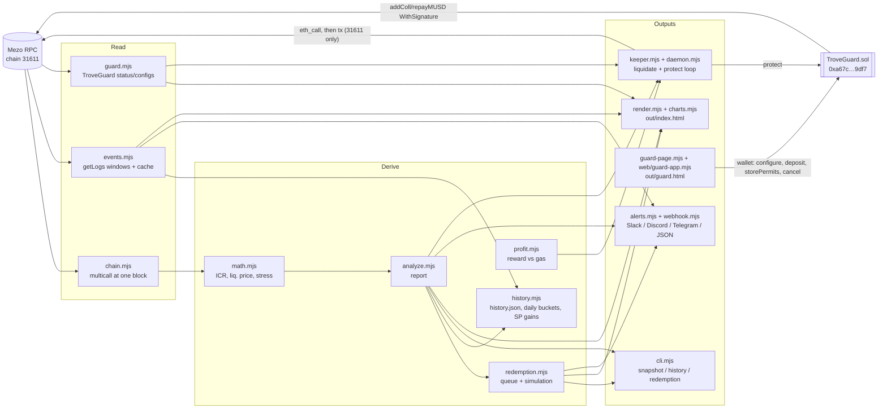

# Architecture

MUSD Trove Radar is a set of small ES modules around one idea: read MUSD state from the chain once,
pinned to a block, and derive every view from that snapshot with exact BigInt maths. TroveGuard is
the one on-chain component, and the keeper is the only part that writes transactions.

## Read layer
* **`chain.mjs`** takes the trove owner list from `TroveManager.getTroveFromTroveOwnersArray`, then batches
  `getEntireDebtAndColl` and `getTroveInterestRate` through multicall, all at one `blockNumber`. System values come
  from the same block: price, MCR/CCR, totals, Stability Pool deposits and BTC, MUSD supply and the global rate.
  Passing an older block reads archive state, which is how `dashboard --backfill` seeds history.
* **`events.mjs`** reads `Liquidation`, `TroveLiquidated`, `Redemption` and `TroveUpdated` in 10,000-block windows.
  A window the RPC rejects is halved, other errors are retried, and the results are cached in `out/events.json` with
  the range they cover. For each liquidation it also measures the Stability Pool's BTC gain from
  `StabilityPoolCollateralBalanceUpdated`.
* **`guard.mjs`** lists guarded borrowers with `guardedSlice` and multicalls `status` and `configs`.

## Derive layer
Pure functions with no I/O, covered by the offline tests:
* `math.mjs` mirrors the Solidity formulas: ICR, NICR, liquidation price, Recovery Mode trigger, buckets and stress.
* `analyze.mjs` builds one report object, and every renderer consumes it.
* `redemption.mjs` rebuilds the `SortedTroves` order off-chain. A live test checks it against an on-chain walk.
* `history.mjs` keeps `history.json` (one row per build) and buckets events per UTC day.
* `profit.mjs` values the keeper's reward against gas: 200 MUSD + 0.5 % of collateral for a liquidation, the BTC tip for `protect`.

## Outputs
* **CLI** (`cli.mjs`): Markdown or JSON snapshot, redemption queue, event history, `liquidatable --simulate`.
* **Dashboard** (`render.mjs`, `charts.mjs`): one static HTML file with inline CSS, JS and SVG. It embeds the
  report, the guard status and history, so it works from `file://`. Its only network request is the optional live
  Stability Pool depositor lookup. CI rebuilds it every 15 minutes and keeps `history.json` in the Actions cache.
* **Guard page** (`guard-page.mjs` bundles `web/guard-app.mjs` with esbuild): an EIP-1193 wallet UI for TroveGuard.
  The EIP-712 permit code (`permits.mjs`) is shared with the CLI, so the browser and Node sign identical digests.
* **Alerts** (`alerts.mjs`, `webhook.mjs`): evaluate thresholds and events, diff against saved state, and deliver
  signed payloads with retries.
* **Keeper** (`keeper.mjs`, `daemon.mjs`, `log.mjs`): dry-runs each target, applies `--min-profit`, broadcasts only
  with `--send` on chain 31611, and runs in a backoff loop with JSON logs. See [run-a-keeper.md](run-a-keeper.md).

## TroveGuard
`contracts/TroveGuard.sol` holds a borrower's BTC and MUSD reserves and a ladder of EIP-712 permits for MUSD's
`BorrowerOperationsSignatures`, keyed by signature nonce. `protect(borrower, upperHint, lowerHint)` is permissionless.
It checks `getCurrentICR < trigger` against the live oracle, spends the permit for the current nonce
(`addCollWithSignature` or `repayMUSDWithSignature`), requires that ICR went up, and pays the caller a BTC tip.
Funds can only go to the borrower's trove, to the caller as the tip, or back to the borrower.
[SECURITY.md](../SECURITY.md) has the threat model.

## Trust boundaries
* Keys are read only by `keeper.mjs#loadAccount`, from `MEZO_PRIVATE_KEY` or a chmod 600 file outside the repo.
  They are never logged, and they never reach the browser. The guard page signs only through the user's wallet.
* Every write is preceded by an `eth_call` of the same call. The keeper refuses any chain other than 31611.
* Everything the dashboard shows comes from the chain. Live tests compare it with `getCurrentICR`, `getNominalICR`
  and a `SortedTroves` walk.
